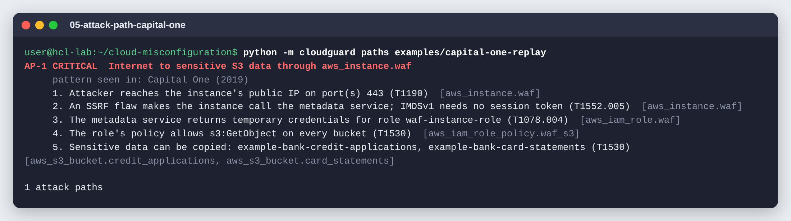
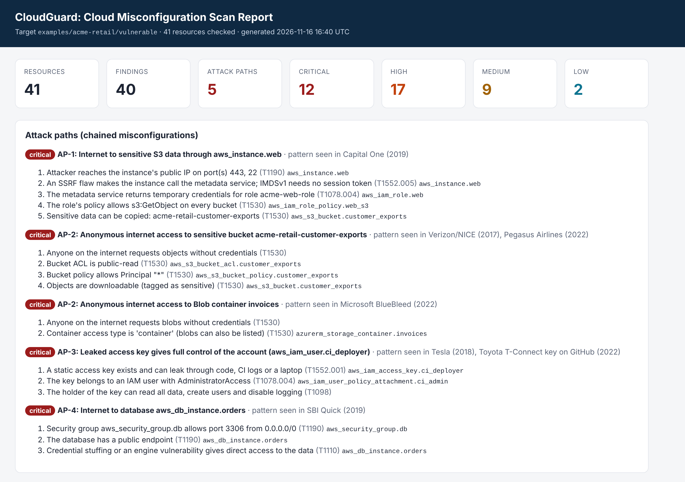
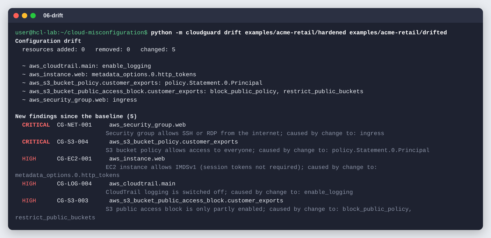
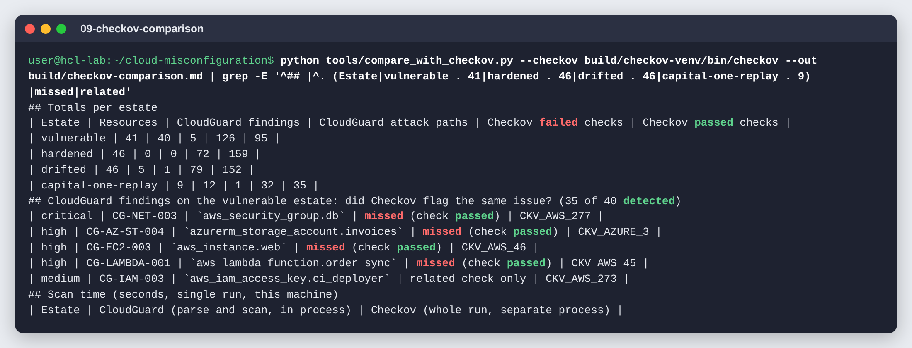

# Security Risks of Cloud Misconfiguration in Enterprise Environments

HCL project report, with CloudGuard, a working policy-as-code scanner for AWS and Azure Terraform.

Most cloud data breaches are caused not by flaws in the cloud platforms but by settings the customer chose or never changed: public storage, over-privileged identities, open ports, missing MFA or disabled logging. This project studies those risks and how to control them:

- **Taxonomy** of twelve misconfiguration classes, mapped to MITRE ATT&CK and NIST SP 800-53 (Chapter 3)
- **Ten real incidents** from 2017 to 2024, including Capital One, Toyota, Pegasus Airlines, BlueBleed, Snowflake customer accounts, Midnight Blizzard and SBI Quick, plus a risk register and heat map for a reference Indian enterprise (Chapter 4)
- **Lifecycle framework** (govern, guardrail, shift left, monitor, respond) with a standards mapping and a 90-day roadmap (Chapter 5)
- **CloudGuard** with 39 YAML rules, attack-path analysis, drift detection, SARIF/HTML reports and a reproducible comparison with Checkov (Chapter 6)

## Download the report

The compiled report is in [`dist/`](dist/):

- `Security-Risks-of-Cloud-Misconfiguration-in-Enterprise-Environments.pdf` (81 pages)
- `Security-Risks-of-Cloud-Misconfiguration-in-Enterprise-Environments.docx` (editable)

Every pull request also builds the report; download it from the **report** artifact of the "Report checks" workflow run.

## Before submission: fill in your details

Edit [`report/metadata.yaml`](report/metadata.yaml) and replace the bracketed placeholders (student name, enrolment number, programme, guide, institute, city), then rebuild with `python tools/build_report.py --pdf`.

## Run it locally

[`docs/LOCAL-SETUP.md`](docs/LOCAL-SETUP.md) is a 14-step guide with a screenshot of every step. In short (replace `<username>` with the account that hosts the repository):

```bash
git clone https://github.com/<username>/Cloud-Misconfiguration-Security-Risks-in-Enterprise-Environments.git
cd Cloud-Misconfiguration-Security-Risks-in-Enterprise-Environments
python3 -m venv .venv && source .venv/bin/activate
pip install -r requirements.txt pytest
python -m pytest -q
```

## Using CloudGuard

```bash
python -m cloudguard scan examples/acme-retail/vulnerable
```

```bash
python -m cloudguard paths examples/capital-one-replay
```

```bash
python -m cloudguard drift examples/acme-retail/hardened examples/acme-retail/drifted
```

```bash
python -m cloudguard scan path/to/terraform --format sarif --output results.sarif
```

`scan` exits with status 1 when a finding at or above `--fail-on` (default `high`) exists, so it can block a pull request. Other formats: `--format json` and `--format html`. `python -m cloudguard rules` lists the rules.

| Example | Resources | Findings | Attack paths |
| --- | ---: | ---: | ---: |
| `examples/acme-retail/vulnerable` | 41 | 40 (12 critical, 17 high) | 5 |
| `examples/acme-retail/hardened` | 46 | 0 | 0 |
| `examples/acme-retail/drifted` | 46 | 5 (all traced to the change that caused them) | 1 |
| `examples/capital-one-replay` | 9 | 12 (none critical on its own) | 1 (critical) |

The Terraform in `examples/` is fictional and deliberately insecure. Do not deploy it.

## Screenshots

| | |
| --- | --- |
|  |  |
| The Capital One chain reconstructed from Terraform | HTML report with attack paths |
|  |  |
| Drift traced to the attribute that changed | Issues Checkov missed on the same code |

## Repository layout

```text
cloudguard/              the scanner: loader, rule engine, attack paths, drift, reporters, CLI
cloudguard/rules/        39 policy-as-code rules (YAML)
examples/                vulnerable, hardened and drifted estates; Capital One replay
evaluation/              CloudGuard vs Checkov comparison results
report/                  report sources: metadata, front matter, 7 chapters, references, appendices, figures
tests/                   105 tests for the scanner and the report tooling
tools/
  build_report.py        Markdown -> formatted DOCX/PDF (HCL report layout)
  check_report.py        structure, numbering and citation checks
  compare_with_checkov.py   reproducible comparison with Checkov
  generate_rule_catalogue.py  builds Appendix B from the rules
  capture_screenshots.py / capture_setup_guide.py   real-run screenshots
docs/                    local setup guide, screenshots, writing guide
dist/                    compiled report for submission
.github/workflows/       automated checks on every pull request
```

## Automated checks

The **Report checks** workflow runs on every pull request and push to `main`:

| Job | What it checks |
| --- | --- |
| Markdown style | `markdownlint-cli2` |
| Report structure and citations | Numbering, figures, placeholders, every `[n]` citation has a reference; `--strict` on `release/*` branches |
| Unit tests | 105 tests, including a vulnerable and a safe case for every rule |
| CloudGuard self-check | The vulnerable estate must fail, the hardened estate must pass, the Capital One replay must produce a path and the drifted estate must report drift; results uploaded as an artifact |
| Build DOCX and PDF | Builds the report with LibreOffice and uploads it |

## How the work was organised

| Issue | Branch | Content |
| --- | --- | --- |
| #1 | `setup/report-build-pipeline` | Report build pipeline |
| #2 | `ci/report-and-scanner-checks` | CI workflow |
| #7 | `feature/cloudguard-scanner` | Loader, rule engine, 39 rules, CLI, examples, tests |
| #8 | `feature/attack-paths-and-drift-detection` | Attack paths, drift, Capital One replay |
| #9 | `content/framework-implementation-and-results` | Chapters 5 and 6, Checkov comparison |
| #4 | `content/introduction-and-background` | Chapters 1 and 2 |
| #5 | `content/misconfiguration-taxonomy` | Chapter 3 |
| #6 | `content/breach-case-studies-and-risk-assessment` | Chapter 4 |
| #10 | `content/conclusion-references-appendices` | Chapter 7, references, Appendices A and B |
| #3 | `content/front-matter` | Certificate, declaration, acknowledgement, abstract |
| #11 | `docs/screenshots-and-local-setup` | Screenshots, local setup guide, Appendices C and D |
| #12 | `release/final-report-v1` | Final build and this README |

## Disclaimer

The incident analysis relies only on public sources. CloudGuard is a research prototype that reads Terraform files; it was evaluated only on the fictional configurations in `examples/` and never against a live cloud account.
