# Running the Project Locally

This guide takes you from a fresh machine to a working scanner and a built
report. Every screenshot shows a real run of the step, made in a new clone
with a new virtual environment.

Replace `<username>` in the clone URL with the GitHub account or
organisation that hosts the repository.

## Step 1: Check the prerequisites

You need Python 3.10 or newer and Git. LibreOffice (`soffice`) is only
needed to build the PDF version of the report.

```bash
python3 --version
git --version
soffice --version
```

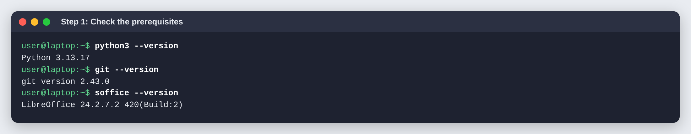

## Step 2: Clone the repository

```bash
git clone https://github.com/<username>/Cloud-Misconfiguration-Security-Risks-in-Enterprise-Environments.git
```

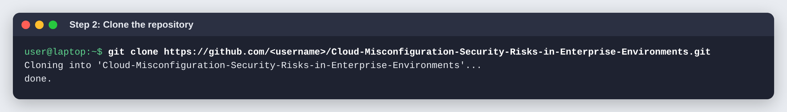

## Step 3: Open the project folder

```bash
cd Cloud-Misconfiguration-Security-Risks-in-Enterprise-Environments
ls
```

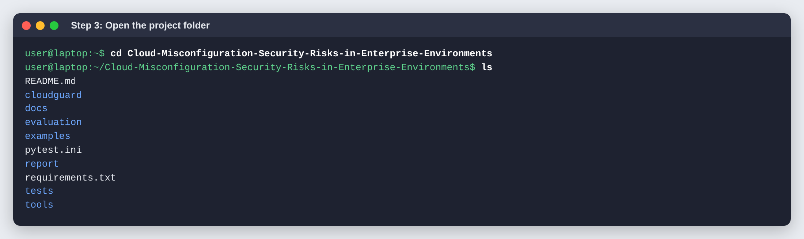

## Step 4: Create and activate a virtual environment

```bash
python3 -m venv .venv
source .venv/bin/activate
```

On Windows (PowerShell), activate with `.venv\Scripts\Activate.ps1` instead.

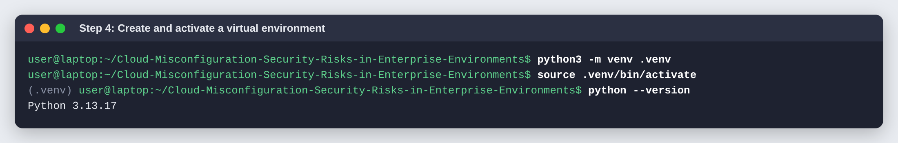

## Step 5: Install the dependencies

```bash
pip install -r requirements.txt pytest
```

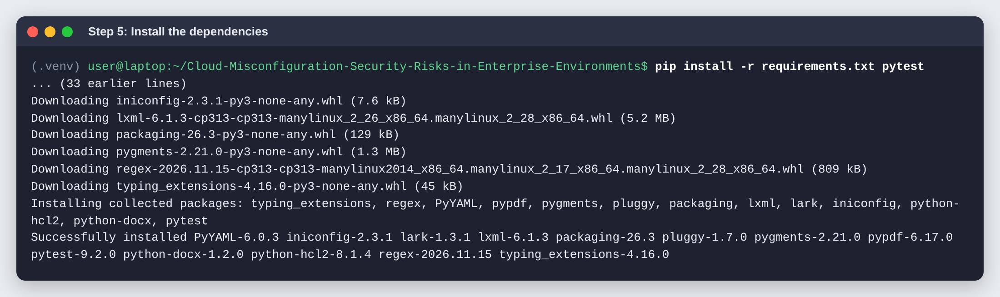

## Step 6: Run the test suite

```bash
python -m pytest -q
```

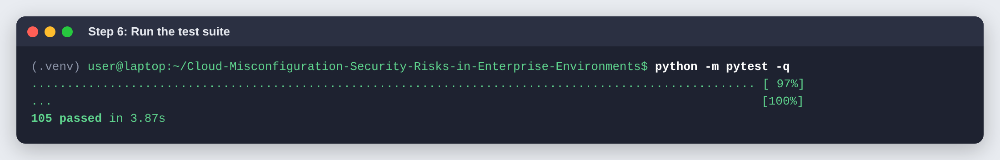

## Step 7: Scan the vulnerable example estate

```bash
python -m cloudguard scan examples/acme-retail/vulnerable --min-severity critical
```

Leave out `--min-severity` to see all 40 findings.

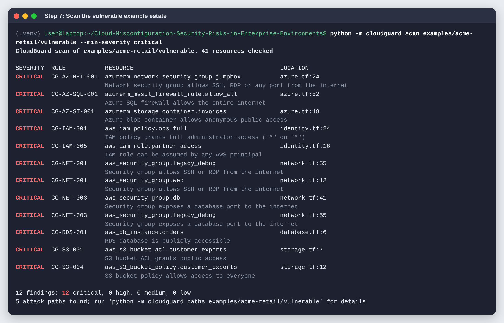

## Step 8: Scan the hardened estate

```bash
python -m cloudguard scan examples/acme-retail/hardened --fail-on low
```

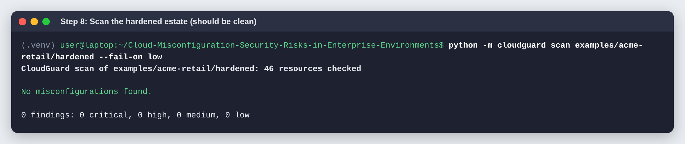

## Step 9: Find attack paths in the Capital One replay

```bash
python -m cloudguard paths examples/capital-one-replay
```

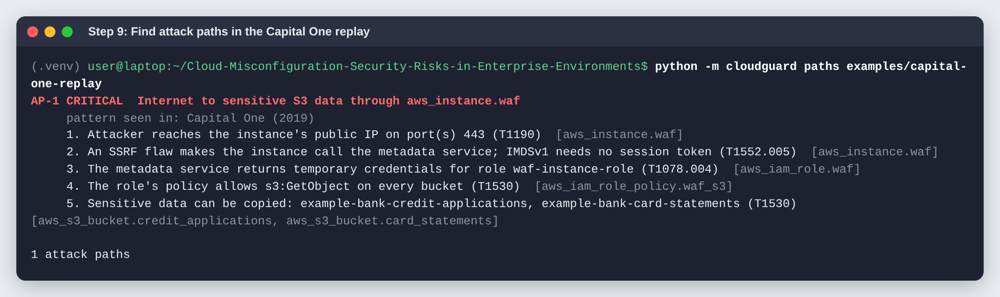

## Step 10: Detect drift against the approved baseline

```bash
python -m cloudguard drift examples/acme-retail/hardened examples/acme-retail/drifted
```

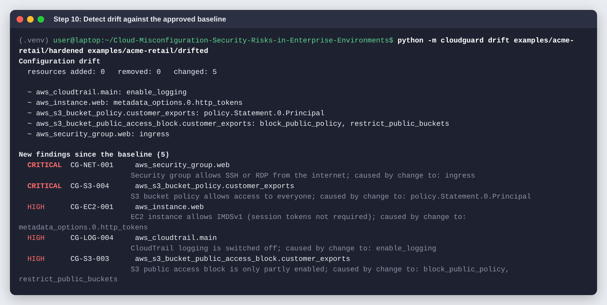

## Step 11: Create the HTML and SARIF reports

```bash
python -m cloudguard scan examples/acme-retail/vulnerable --format html --output build/report.html --fail-on none
python -m cloudguard scan examples/acme-retail/vulnerable --format sarif --output build/cloudguard.sarif --fail-on none
```

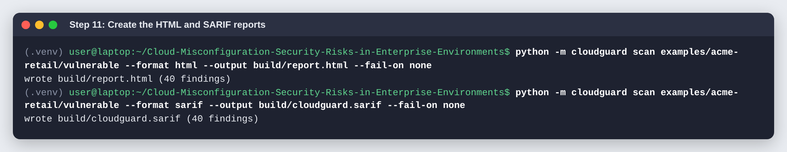

## Step 12: Open the HTML report in a browser

Open `build/report.html` (double-click it, or run `xdg-open build/report.html`
on Linux or `open build/report.html` on macOS).

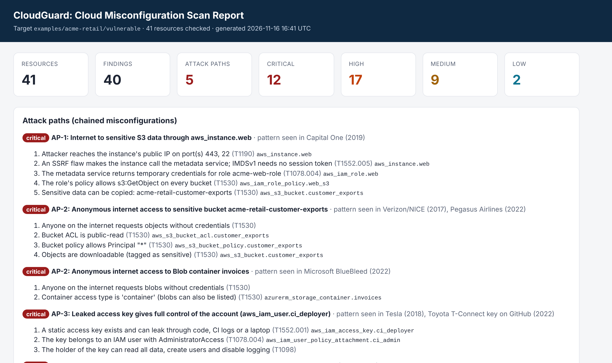

## Step 13: Build the project report as DOCX and PDF

Fill in your details in `report/metadata.yaml` first, then:

```bash
python tools/build_report.py --pdf
```

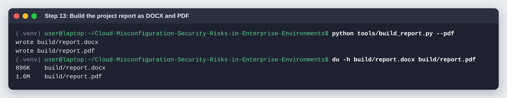

## Step 14: Open the built report

The report is written to `build/report.pdf` and `build/report.docx`.

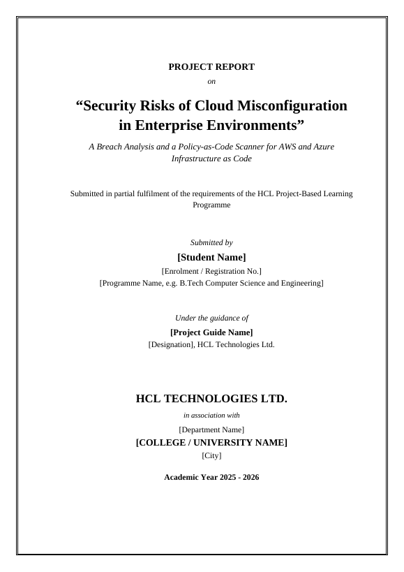

## Scanning your own Terraform

```bash
python -m cloudguard scan path/to/your/terraform
```

Use `--format sarif --output results.sarif` in CI and `--fail-on high` (the
default) to block a pull request on critical or high findings.

## Re-capturing the screenshots

```bash
NODE_PATH=$(npm root -g) python tools/capture_setup_guide.py
NODE_PATH=$(npm root -g) python tools/capture_screenshots.py
```

Both scripts run every command for real and need Node.js with Playwright and
`pdftoppm` (poppler-utils). The Checkov comparison screenshot also needs
Checkov installed at `build/checkov-venv/bin/checkov`.
